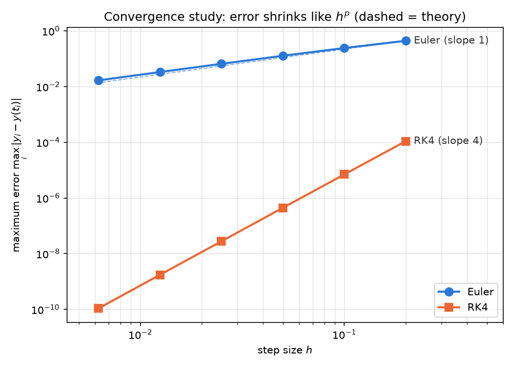

# Simulation Verification Lab

**Verifying numerical simulation and quantitative reasoning — the core skill behind evaluating AI-generated technical work.**

AI models can now write simulation code and quantitative analysis that *looks* right. Judging whether it actually *is* right takes a practitioner: someone who builds a trusted reference solution, designs checks that separate correct work from plausible-but-wrong work, and explains exactly where a flawed answer breaks.

This repository builds that skill set step by step, in my own field of applied mathematics (numerical methods, ODEs/PDEs, and Stokes flow simulation from my M.S. thesis).

**Author:** Bernard Frimpong — M.S. Applied Mathematics, University of Akron (2026) · B.S. Mathematics, KNUST
**GitHub:** [bernardfrimpong040-pixel](https://github.com/bernardfrimpong040-pixel)

---

## The workflow this project practises

Every stage follows the same professional cycle:

1. **Pose** a technical problem precisely, with a known or independently checkable answer.
2. **Build a reference solution** that is simple, readable and verified.
3. **Verify** it with checks that a wrong answer cannot pass (exact solutions, convergence rates, conservation laws, statistical coverage).
4. **Evaluate** other solutions — deliberately flawed ones and real AI-generated ones — against those checks.
5. **Explain** what is wrong, why, and what the correct reasoning is, in clear writing.
6. **Record** results so anyone can reproduce them.

## Roadmap and progress

| Stage | What is built | Skill demonstrated | Status |
|---|---|---|---|
| 1 | Reference ODE solvers (Euler, RK4) with a convergence study against an exact solution | Building and verifying a reference solution | ✅ Done |
| 2 | Automatic tests with `pytest`: exact solution, order of accuracy, invalid inputs, plus deliberately buggy solvers the tests must catch | Writing checks that separate correct from flawed work | ⏳ Next |
| 3 | Stiff problems and stability: a problem where the "obvious" method gives a confident wrong answer; written as a problem statement, reference answer and grading rubric | Designing problems that expose shallow reasoning | |
| 4 | Grading AI responses: real chatbot answers to Stages 1–3 problems, run against the tests, scored with the rubric, with written critiques | Evaluating AI-generated technical work | |
| 5 | Monte Carlo simulation and statistical inference: confidence intervals with coverage checks, A/B-test power by simulation | Statistical inference and experiment design | |
| 6 | Regression and time-series forecasting: honest validation, leakage traps, error metrics | Predictive modelling and forecasting | |
| 7 | Capstone in my research area: regularized Stokeslets for Stokes flow past a sphere, verified against the exact drag 6πμaU | Domain expertise in simulation | |
| 8 | Final report: evaluation log summary, lessons on common AI failure modes | Clear technical writing | |

Detailed notes for each stage are in `STAGEn_GUIDE.md`, and a dated log is in [`PROGRESS.md`](PROGRESS.md).

---

## Stage 1 result: a verified reference solver

**Problem.** y′ = y − t² + 1, y(0) = 0.5, on 0 ≤ t ≤ 2. Exact solution: y(t) = (t + 1)² − 0.5eᵗ.

**Method.** Solve with Euler's method and classical RK4 on 10, 20, 40, 80, 160 and 320 steps. Measure the maximum error against the exact solution, then the observed order of accuracy p from p = ln(E₁/E₂) / ln(h₁/h₂).

| n | h | Euler error | order | RK4 error | order |
|---:|---:|---:|---:|---:|---:|
| 10 | 0.20000 | 4.397e-01 | – | 1.089e-04 | – |
| 20 | 0.10000 | 2.420e-01 | 0.86 | 6.990e-06 | 3.96 |
| 40 | 0.05000 | 1.275e-01 | 0.92 | 4.421e-07 | 3.98 |
| 80 | 0.02500 | 6.550e-02 | 0.96 | 2.779e-08 | 3.99 |
| 160 | 0.01250 | 3.321e-02 | 0.98 | 1.742e-09 | 4.00 |
| 320 | 0.00625 | 1.672e-02 | 0.99 | 1.090e-10 | 4.00 |



**Findings.**
- Both methods converge at their theoretical rates: Euler → 1, RK4 → 4. The self-check passes (tolerance ±0.1 on the finest pair of grids).
- RK4 with h = 0.2 gives y(2) ≈ 5.3053630, matching the published textbook value, an independent cross-check.
- **A single number is weak evidence; the order of accuracy is strong evidence.** An RK4 with two weights swapped still produces a plausible answer (error ≈ 3×10⁻³), but its observed order collapses from 4 to 1. The convergence study catches this immediately. That is exactly the kind of error to look for when grading AI-written simulation code.

### First evaluation: grading an AI answer

Using the verified solver, I checked an AI-style response claiming that RK4 with h = 0.5 gives y(2) accurate to five decimals and that halving h cuts the error by 4.

| Claim | Verified |
|---|---|
| y(2) ≈ 5.30547 | RK4 gives **5.30161** (5.30547 is the *exact* value) |
| Accurate to 5 decimals | Error 3.9 × 10⁻³, only **2** decimals |
| Halving h divides error by 4 | Measured **14.75**; theory 2⁴ = **16** |

**Verdict: incorrect, three errors**, including a *fabricated agreement* (the response compared the exact value with itself). Full analysis and written critique: [`evaluations/stage1_rk4_step_size_review.md`](evaluations/stage1_rk4_step_size_review.md).

---

## How to reproduce

Requires Python 3.13. On Windows (PowerShell), from the project folder:

```powershell
py -3.13 -m venv .venv
.\.venv\Scripts\Activate.ps1
python -m pip install -r requirements.txt
python run_stage1.py
```

The script prints the table, saves `results/stage1/convergence_table.csv` and `results/stage1/convergence_plot.png`, and ends with `RESULT: ALL CHECKS PASSED` (exit code 0) or `SOME CHECKS FAILED` (exit code 1).

## Project structure

```
simulation-verification-lab/
├── simlab/                  # the reusable code (a Python package)
│   ├── __init__.py          # marks the folder as a package
│   ├── ode_solvers.py       # Euler, RK4 and verification helpers
│   └── problems.py          # test problems with exact solutions
├── results/
│   └── stage1/              # table and plot produced by run_stage1.py
├── evaluations/             # graded reviews of AI-style answers
│   └── stage1_rk4_step_size_review.md
├── run_stage1.py            # Stage 1 convergence study with self-check
├── STAGE1_GUIDE.md          # step-by-step guide, maths and Python explained
├── PROGRESS.md              # dated progress log
├── requirements.txt         # pinned library versions
└── .gitignore
```

## Tools

Python 3.13 · NumPy · Matplotlib · SciPy (from Stage 3) · pytest (from Stage 2)
